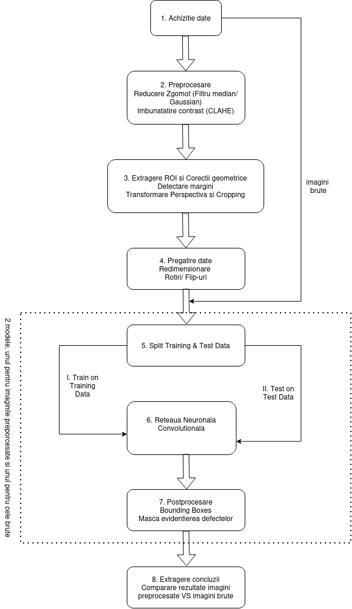

# Proiect-PI
# ☀️ Solar Panel Defect Detection: A Computer Vision & Deep Learning Approach

**Panourile solare** sunt menite sa aiba o durata de viata de pana la 30 de ani, insa anumite defecte si probleme de performanta pot aparea cu mult inainte de acest termen. [ 2025 Global Solar Report by Raptor Maps](https://raptormaps.com/resources/global-solar-report-2025), un studiu realizat in 2025, atesta ca lipsa de performanta cauzata de echipamente a crescut cu peste 200% din 2019, estimand o pierdere de peste 10 miliarde de dolari in energie doar in anul 2024.

Inspectia manuala a panourilor solare este inceata, scumpa si predispusa la erori. Pentru un parc solar de 100 MW, verificarea poate dura luni, iar primele panouri verificate se pot degrada pana cand cele din urma ajung sa fie testate. 

Acest proiect exploreaza automatizarea detectarii defectelor pe panourile solare, imbinand tehnici clasice de procesare a imaginilor cu retele neuronale convolutionale (CNN). Obiectivul principal este de a demonstra si cuantifica impactul unui pipeline riguros de preprocesare asupra performantei modelelor de Machine Learning.

Pentru a valida eficienta tehnicilor de *Computer Vision*, proiectul antreneaza si compara doua arhitecturi in paralel:
*   **Baseline:** Un model antrenat exclusiv pe imaginile brute (raw data).
*   **Enhanced:** Un model antrenat pe imagini trecute printr-un pipeline de preprocesare si extragere ROI (filtrare zgomot, ajustare contrast prin CLAHE, detectare margini si corectii de perspectiva).

# **SCHEMA BLOC**

1. **Achizitia de date**
    - Colectarea setului initial de imagini cu panouri solare.

    - O copie a imaginilor sare peste etapa de preprocesare, pentru a realiza o comparatie de performanta

2. **Preprocesare**
    - Se aplica algoritmi pentru imbunatatirea calitatii vizuale

3. **Extragere Region of Interest**
    - Se elimina datele inutile din fundal, se indreapta imaginea si se distinge conturul panourilor

    - Dupa aceste prelucrari, se realizeaza un cropping precis pe suprafata panourilor

4. **Pregatirea datelor**

    - Se modifica imaginile la o dimensiune standard pentru modelul de Machine Learning
    
    - Rotirile si Flip-urile au rol de a multiplica artificial setul de date pentru a oferi mai multe exemple

5. **Split data**

    - Se impart imaginile in 2 categorii
        - De training, in proportie de 70-80 %
        - De test, in proprotie de 20-30 %

6. **Reteaua Neuronala Convolutionala**

    - Nucleul proiectului
    - Proceseaza datele de training pentru a invata tipare

7. **Postprocesare**

    - Deciziile retelei sunt transformate in rezultate vizuale usor de inteles
    - Se traseaza Bounding Boxes si se aplica masti  care sa identifice defectele 

8. **Extragere concluzii**

   - Se determina metricii de performanta si se analizeaza diferentele intre cele 2 modele, evidentiand necesitatea si eficienta tehnicilor de Prelucrare de Imagini

# Header tabel pentru analiza literaturii de specialitate (state-of-the-art).

 | Nr. | Autor(i) / An | Titlul articolului / proiectului | Aplicație / Domeniu | Tehnologii utilizate | Metodologie / Abordare | Rezultate | Limitări | Comentarii suplimentare |
| :--- | :--- | :--- | :--- | :--- | :--- | :--- | :--- | :--- |
| **1** | Rifat Al Mamun Rudroa, Kamruddin Nura, Md. Faruk Abdullah Al Sohana, M.F. Mridhaa, Sultan Alfarhoodb, Mejdl Safranb, Karthick Kanagarathinam / 2024 | SPF-Net: Solar panel fault detection using U-Netbaseddeeplearningimage classification | Deep learning model classifier | InceptionV3, U-Net | Se imparte in 4 etape : Image Collection,Solar panel segmentation(using image processing U-Net algorithms to create masking), building a system for error categorization,analyzing the imapct of power consumption. | Exceptional performance having a validation accuracy of 98.34%, a test accuracy of 94.35% | The models are overfitting as they struggle to generalize their learning to unseen data. | |
| **2** | Dhairya Hindoriya / 2024 | Solar panel fault detection | Detectia si clasificarea defectelor pe panourile solare pe baza unui deep learning model antrenat pe un dataset cu fiecare tip de defect. | Jupyter Notebook, Tensorflow | Separarea defectelor in 6 clase:'Bird-drop', 'Clean','Dusty','Electrical-damage','Physical-damage','Snow-covered'. | Acurateatea de detectare a defectelor de 98% pe antrenarea modelului, iar 84% pe validarea rezultatului, in functie de defectul specific panoului. | Set de date mic. Lipsa prelucrarii/transformarii imaginilor. | |
| **3** | Jamilatul Mutasaroh,Bimo Prawiradijaya, Yoga Yudha Tama, Laras Wati, Nicholas Dominic / 2024 | Automaetd Real-Time Monitoring and AI Fault Detection System for Solar Panels Using Advanced Image Detection | An automatic failure detection System which uses AI to analyze images of solar panels at frequent intervals. | YOLOv8,opencv-python,streamlit,ultralytics | Colectarea dataset-ului si preprocesarea imaginilor prin etichetare si detectie de obiecte. Antrenarea modelului YOLOv8. Implementarea aplicatiei. | Precizie de 82% pentru validarea rezultatului. | Rata de recall mica 72.1% (identificarea de obiecte reale, unele defecte pot ramane nedetectate).Detectarea exclusiva a defectelor vizibile. | https://universe.roboflow.com/6rainstorm-data-train/solar-panel-faulty-od-final/dataset/5 |
| **4** | Joseph Fiori,Rafaela Frota,Sofia Oliveira, Mubarak Shah,Dylan Colvin, Rohit Gupta, Hubert Seigneur, Shruti Vyas, Kristopher Davis / 2022 | Automated Defect Detection and Localization in Photovoltaic Cells Using Semantic Segmentation of Electroluminescence Images | Deep learning based on semantic segmentation model that identifies and segments defects in electroluminescence (EL) images of silicon photovoltaic (PV) cells. | PyTorch,OpvenCV,DeepLabv3 | Procesarea de imagini grayscale de diferite dimensiune, aleator redimensionate,centrate, adauga transformari de tip blur pe setul de training pentru a ajuta modelul sa generalizeze. | The proposed model attains per-class F1 scores of 0.98, 0.81, 0.58, 0.33, and 0.78 for no-defect, crack, contact, interconnect, and corrosion defects. | Setul de date combină defectele apropiate într-o singură zonă mare, astfel există riscul să rateze defectele minore. | |
| **5** | Mostafa A. Ebied, Amr Munshi, Shakir A. Alhuzali, Mohamed M. El-sotouhy, Amr I. Shehta & M. S. Elborlsy / 2025 | Advanced deep learning modeling to enhance detection of defective photovoltaic cells in electroluminescence images | This paper discusses a deep learning approach for detecting defects in photovoltaic (PV) modules using electroluminescence (EL) images. | CNN-based architectures—DenseNet169, DenseNet201, ResNet101, ResNet152, SENet154, VGG16, and VGG19, integrated generative adversarial network (GAN)-based augmentation | To address data scarcity challenges, we implement a two-stage augmentation pipeline where the GAN model first generates synthetic samples, which are then combined with the original dataset for subsequent CNN training. This hybrid approach significantly improves augmentation efficiency in data-limited scenarios. In our study, we implemented a GAN-based oversampling strategy referred to as AUG300, in which 300 synthetic images were generated per class, regardless of the original class balance. | The proposed system not only achieved a peak classification accuracy of 90.13% using ResNet152 but also demonstrated high robustness, reduced training time, and superior generalization across defect types and cell categories. This positions our framework as a scalable and deployment-ready solution for real-world photovoltaic quality inspection systems. | Despite the promising results, this study has certain limitations. The reliance on EL image datasets means that performance may vary when applied to different imaging modalities or real-time operational environments. Additionally, the computational cost of training deep models like ResNet152 and DenseNet201 may pose challenges for deployment on low-resource devices. | |

## Bibliografie

1. Greenlancer - [*Solar Panel Damage & Defects: Signs, Causes & What to Do*](https://www.greenlancer.com/post/common-solar-panel-defects) 
2. Raptor Maps - [ 2025 Global Solar Report by Raptor Maps](https://raptormaps.com/resources/global-solar-report-2025)
3. Datature - [Why Solar Inspection Needs Automation](https://datature.io/blog/solar-panel-defect-detection-with-vision-ai-from-drone-thermography-to-deployed-models)

4. [draw.io](https://www.drawio.com/)

5. [Google Gemini](https://gemini.google.com/app)
